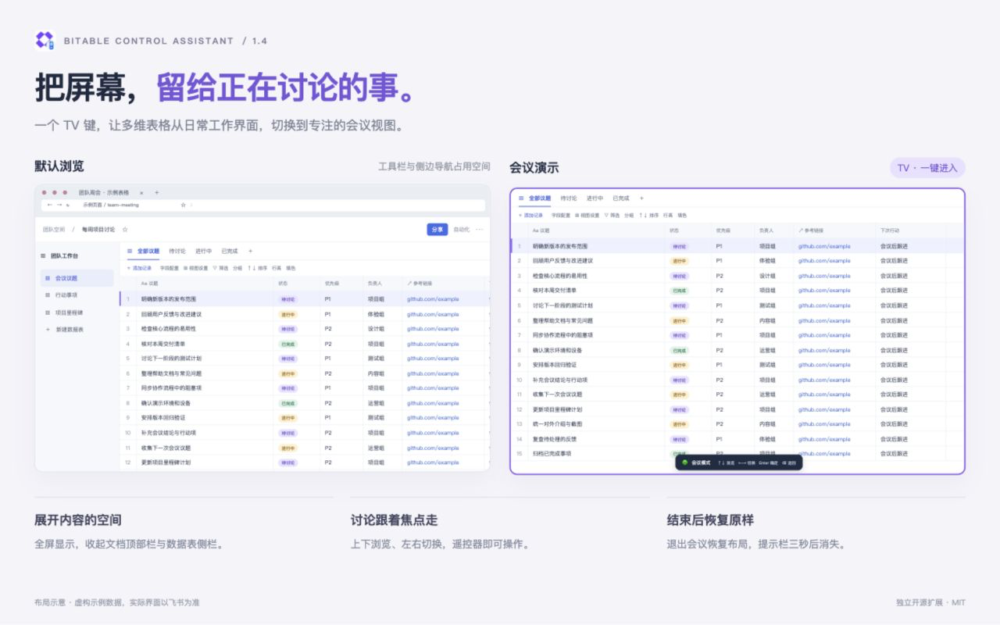

# 更新记录

## 1.4.2 — 2026-10-23

- 修复刷新后会议已恢复、侧栏却漏收起的问题：等待实际侧栏出现，并处理飞书随后重绘或恢复侧栏偏好的情况；用户主动操作后停止自动调整。
- 退出会议恢复侧栏原先展开或折叠的状态；刷新期间保留进入会议前的状态。
- 从浏览器前进/后退缓存返回会议时，重新登记会议标签页与全屏状态，保留页面现有输入。
- 网站会话存储不可用时降级为内存偏好，避免会议开关报错；不会额外保存记录或评论。
- 校验页面绘制信息的结构、数量和坐标，拒绝异常内容；可选 TV 浏览器命令使用触发时的标签页，避免焦点变化后误操作。
- 增加明确的本地代码安全策略和打包检查，完善本机数据处理、Limited Use 声明及商店审核步骤。
- 保留现有自定义快捷键、双击空框返回与原自定义缩放方案，无新增权限。89 项自动检查通过；[完整检查报告](docs/AUDIT-v1.4.2.md)与[验证范围](docs/TESTING.md)。

## 1.4.1 — 2026-10-23

- 正式更名为「多维表格控制助手」（Bitable Control Assistant）。扩展界面、配置导出、GitHub 图文和商店材料统一使用新名称，旧名配置文件仍可导入。
- 空输入框需要在 500 毫秒内独立按两次返回才退出输入，后续单按逐层返回。删掉最后一个字不计入双击；长按连发不能误退出。
- 输入、焦点切换、鼠标操作、选词、窗口失焦或其他按键会取消第一次返回确认。
- 音量沿用原自定义组合键、缩放步长和有序队列；新增可选「使用原生快捷键」开关，默认关闭。原生模式使用 Chrome 的缩放档位，关闭后恢复原自定义键。
- 原生缩放后，会议提示栏同步显示浏览器实际比例；较早的自定义缩放回包不会覆盖新的比例。
- 77 项自动检查通过。使用者已确认并修复遥控映射软件造成的快速连按失效，扩展保留原缩放方案。

## 1.3.0 — 2026-10-23

### 电源键可跨标签页刷新

新增 Chrome 命令「电源键：刷新当前标签页（所有网站）」，默认 Control + Shift + 8。与 Home 一样可在 Chrome 扩展快捷键中自定义，GitHub 等页面无需内容脚本或额外站点权限。使用者已在真实遥控器上确认可以刷新 GitHub。

设置页显示并支持复制 Chrome 实际保存的电源 / Home 组合键；原页面刷新动作保留为备用，不覆盖旧配置。

### 更完整的图文说明

README 增加默认浏览与会议演示的布局对比、详情评论示意和真实设置页截图。新增安装排查指南、逐项商店填写资料、审核测试步骤以及完整发布材料包。示意图使用虚构数据；不公开内部表格截图。

验证：66 项自动检查通过；原生 Command + R 在真实 GitHub 页面复测成功，新电源命令由使用者完成遥控器验收。[详细范围](docs/TESTING.md)。

## 1.2.0 — 2026-10-23

- 电源默认使用 Chrome 原生刷新键，新增可自定义的页面重新加载动作。
- 缩放键独立处理，避免编辑器弹层、HUD 焦点及表格短暂重绘吞键；短批次合并浏览器缩放写入，保留每次增减，并重试 Chrome 暂时忙碌的情况。
- 链接停靠点只适用于“超链接”字段，普通文本中的链接不额外增加停靠点。
- TV 开启会议时默认隐藏文档顶部栏并回收空间；退出恢复，设置中可关闭。
- 退出会议后提示栏 3 秒自动隐藏，页面更新或迟到的缩放响应不会使它重新常驻。
- 注册现有 128/256 像素图标供 Chrome 选择，保留原图设计；SVG 不是 Chrome 扩展图标支持的格式。
- 配置升级到版本 5，保留现有自定义按键；新增刷新键有冲突时留空，不覆盖旧动作。

## 1.1.0 · 2026-10-23

- Home 改为跨标签页回到正在会议模式的多维表格，电源键默认留空。
- 菜单键改为切换评论，展开时自动聚焦，收起时保留草稿。
- TV 开启全屏时自动收起侧边栏，退出时恢复原状态。
- 返回键在有文字时删除左侧字符；空输入框或非输入状态下逐层返回。长按删除不会连续退出多个界面。
- 跳过折叠容器里的预渲染选项，修复上下导航在同一字段停留的问题。
- 链接高亮时将键盘焦点留在字段容器，防止原生富文本编辑器抢走 Enter；无需修改已有链接字段。
- 保留原生快捷键开关及每项复制按钮，旧菜单组合键自动迁移。Home 的跨标签页组合键仍由 Chrome 单独管理。
- 51 项自动检查、Chrome 示例页面真实按键测试通过；真实飞书验证范围见 docs/TESTING.md。

## 1.0.0 · 2026-10-22

首个开源正式版本。

- 列表上下切记录、左右切视图；详情上下聚焦字段并滚动长文本、左右切记录。
- OK 操作当前字段；字段链接在新标签页打开。
- 文字输入状态保留原生方向键；自定义方向组合键可移动光标。
- 返回键仅删除左侧文字；Home 先退出输入，再收起评论、关闭详情。
- 详情和侧边栏支持「使用原生快捷键」开关；每个快捷键有复制键值按钮。
- 保留全屏会议、跨标签页返回会议、连续缩放、草稿保护和旧配置迁移。
- 附 MIT 许可证、隐私政策、开发测试与打包脚本、GitHub Actions 检查。

验证：43 项自动检查、运行资源检查、Chrome 示例页面真实按键测试、真实飞书原生侧边栏验证通过。实际设备输入法和飞书各类自定义卡片布局需要使用者加载后确认。
