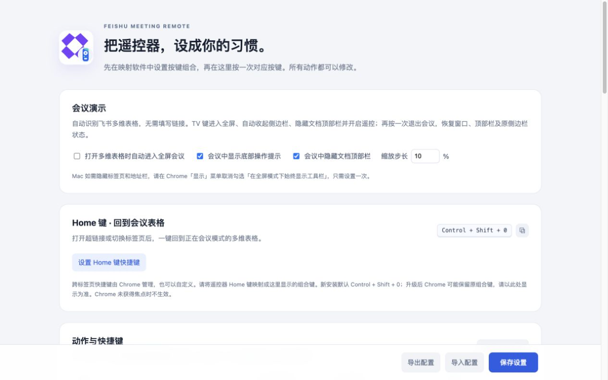

# 飞书会议遥控器 · v1.2.0

用遥控器或键盘浏览飞书多维表格、聚焦详情字段、打开链接和输入评论。适合投影会议。遥控器由现有映射软件转成键盘组合键，扩展不连接蓝牙，也不替代语音输入法。

这是独立开发的扩展，与飞书及其运营方没有隶属关系。

## 使用

在 Chrome 中打开任意飞书多维表格，无需填写表格链接。点击扩展菜单或按 TV 对应组合键开启会议模式。所有按键均可自定义；跨标签页的 Home 键在 Chrome 扩展快捷键设置中配置。

| 遥控按键 | 列表浏览 | 详情浏览 | 文字输入 |
| --- | --- | --- | --- |
| 上 / 下 | 上一条 / 下一条记录 | 聚焦上一 / 下一字段；长文本先滚动到边界 | 原生方向键移动光标、选词 |
| 左 / 右 | 上一 / 下一视图 | 上一条 / 下一条记录 | 原生方向键移动光标、选词 |
| OK | 展开详情 | 操作聚焦字段；超链接字段在新标签页打开；最后一个焦点为评论入口 | 评论框中发送；普通字段交给飞书 |
| 返回 | 提示已回到列表 | 收起评论，再关闭详情 | 有文字时删除左侧字符；空输入框先退出输入 |
| Home | 从任意标签页回到正在会议模式的表格 | 同左 | 同左 |
| 菜单 | 展开当前记录并打开评论 | 打开并聚焦评论；再次按下收起 | 收起评论并保留草稿 |
| TV | 开启全屏、收起侧边栏并隐藏文档顶部栏；退出时恢复 | 同左 | 同左 |
| 电源 | 重新加载当前浏览器页面 | 同左 | 同左 |
| 音量 ＋ / − | 连续缩放当前标签页 | 同左 | 同左 |
| 语音 | 沿用现有语音输入法 | 沿用现有语音输入法 | 将语音文字输入当前编辑框 |

详情的紫色边框表示当前字段，链接另有蓝色边框。仅类型为“超链接”的字段逐链接落焦；正文中的链接保留为普通文字内容，不额外增加停靠点。只读字段保持只读；可编辑字段按 OK 进入飞书原生编辑控件。表格修改的保存规则由飞书处理。评论有草稿时，切记录、切视图和关闭详情会被阻止；收起评论保留原输入节点。刷新或关闭网页前请先处理草稿。

## 默认组合键

- 方向键：↑ / ↓ / ← / →；确定：Enter；删除 / 逐层返回：Backspace。
- Home：Control + Shift + 0；备用返回：Escape。
- TV：Control + Shift + 9；电源：Mac 为 Command + R，Windows 为 Control + R。
- 菜单切换评论：Page Down；放大 / 缩小：Control + Shift + = / −。
- 展开评论并聚焦：Control + Shift + C。
- 展开详情：Mac 为 Command + E，Windows 为 Control + E。
- 可另设「回到首个视图」「上一条 / 下一条记录（独立）」等动作。

电源默认使用 Chrome 原生刷新键，在其他标签页和会议暂停时也可使用。如果改为扩展自定义组合键，则在飞书多维表格内容区生效，有未发送评论时会先要求处理草稿。原生刷新遵循浏览器本身的行为。

长按返回只连续删字；删空后松开再按才会逐层返回，避免一口气退出多个界面。Home 由 Chrome 管理，升级后可能保留旧组合键，请以设置页显示的实际键值为准，并将遥控器 Home 映射为该值。

Mac 的 **Control** 与 **Command** 分别录入，不能互换。设置页的每个组合键旁都有复制按钮，复制标准键值，如 `Control+Shift+Digit0`，便于填写映射软件。不同映射软件也可使用按键录入方式。

## 使用原生快捷键

「展开详情」和「侧边栏」提供逐项开关，依据[飞书官方快捷键说明](https://www.feishu.cn/hc/zh-CN/articles/360049067880)。开启后显示对应平台的原生组合键，扩展放行真实键盘事件，由飞书处理；请同时将遥控器映射改为显示的组合键。关闭开关后恢复该动作原来的自定义键。不会用合成按键冒充原生事件。

「重新加载当前页面」也提供 Chrome 原生开关，默认开启。删除和文字输入中的方向键本来就保留原生行为。未列出开关的动作暂不声明有完全等价的飞书原生快捷键。

## 更新与安装

本地安装：Chrome 地址栏手动打开 `chrome://extensions`，开启开发者模式，选择「加载已解压的扩展程序」，选择含 `manifest.json` 的文件夹。更新已安装版本时覆盖同一文件夹并点击重新加载，再刷新飞书页面。加载后不要移动该文件夹。

从 v1.1.0 更新：保留已有按键；增加电源刷新和默认开启的顶部栏隐藏。如果已有动作占用了默认刷新键，则不会覆盖它，新刷新动作会留空供手动设置。

从更早版本更新：保留方向键、缩放等自定义组合；原菜单（侧边栏）键迁移为「切换评论」，侧边栏仍可单独自定义或启用原生快捷键。原页面内 Home 绑定移除，Home 改用 Chrome 的「回到会议」命令。旧版电源键所用的 Chrome 命令可能保留原组合，设置页会显示实际值；可重新映射遥控器 Home，或在 Chrome 中修改组合键。已有空白的可选动作仍保留空白。

## 全屏和返回会议

TV 使用 Chrome 原生窗口全屏。Mac 若仍显示地址栏和标签页，可在 Chrome「显示」菜单取消勾选「在全屏模式下始终显示工具栏」。进入会议时自动折叠数据表侧边栏，并隐藏包含文档路径、分享和自动化的顶部栏，把空出的高度交给表格。退出时恢复顶部栏及侧边栏原来的展开状态，底部提示在 3 秒后消失。可以在设置中关闭「会议中隐藏文档顶部栏」。退出会议也会恢复由扩展改变的窗口状态。一个窗口有多个开启会议的标签页时，最后一个退出后恢复窗口。

Home 在 Chrome 获得焦点时跨标签页生效，优先回到最近开启且仍在会议模式的表格。如果该会议已经退出，会尝试其他仍在会议模式的标签页；没有会议时给出提示。不会把其他网页替换为旧会议链接。退出浏览器后清空临时会议信息。

## 图标

工具栏与扩展图标使用 PNG，已声明 16、32、48、128、256 像素的现有资源供 Chrome 按显示密度选择。Chrome 不支持直接以 SVG 作为扩展图标；更大的源图也无法增加 16 DIP 工具栏中可见的细节，复杂图案可能需要专门的小尺寸简化稿。参见 [Chrome action 图标说明](https://developer.chrome.com/docs/extensions/reference/api/action#icon)。本次保留原图设计。

## 支持范围

- 支持 `*.feishu.cn` 下的 Base、知识库中的多维表格及分享页面，需已有相应访问权限。
- 记录导航针对表格视图；详情字段导航适配当前标准记录卡片。看板、甘特、日历、自定义小组件等布局尚未完整适配。
- 输入法组合文字期间保留原生按键，避免误发送。自定义方向组合键支持编辑器光标移动；复杂第三方编辑器建议映射为原生方向键。
- 不调用飞书私有数据 API；通过页面中已有控件操作。飞书界面变化可能需要更新适配。

## 隐私与权限

仅申请本机配置存储和飞书站点访问，无分析统计、外部后端、录音权限或调试器权限。画布中的记录文字和位置只用于页面内导航并暂存在内存；会议链接只暂存在 Chrome 会话存储。评论通过用户已登录的飞书页面发送。复制按钮仅在点击时写入所选快捷键，不读取剪贴板。详见 [隐私政策](https://github.com/YinsenWANG/feishu-meeting-remote/blob/main/PRIVACY.md)。

## 开发与验证

[GitHub 源码](https://github.com/YinsenWANG/feishu-meeting-remote) 使用 MIT 许可证。开发环境为 Node.js 24，运行时不依赖 npm 包。源码仓库中的 `extension/` 可直接加载；执行 `npm ci`、`npm test`、`npm run check` 检查代码，`npm run package` 生成根目录含 manifest 的商店 ZIP。

具体通过项目及真实设备验收边界见 [验证记录](docs/TESTING.md)。自动检查与示例页面测试不等同于所有飞书布局、系统输入法及遥控设备的兼容保证。
