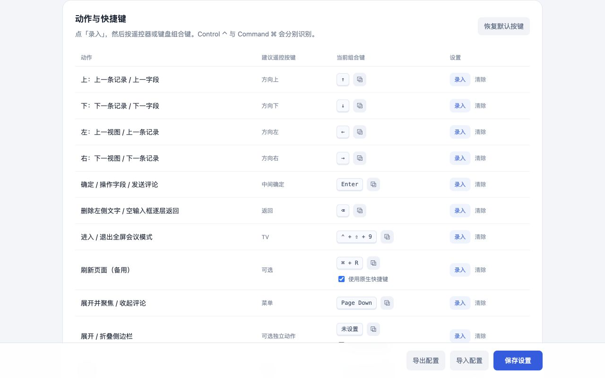

# 安装、映射与升级

## 首次安装

1. 从 [GitHub 最新发布](https://github.com/YinsenWANG/feishu-meeting-remote/releases/latest) 下载名称以 `-chrome.zip` 结尾的文件，不要下载 GitHub 自动生成的 Source code。
2. 解压到一个准备长期保留的文件夹。
3. 在 Chrome 地址栏手动打开 `chrome://extensions`，开启右上角「开发者模式」。
4. 点击「加载已解压的扩展程序」，选择直接包含 `manifest.json` 的文件夹。
5. 打开飞书多维表格并刷新。扩展会自动识别页面，无需填写表格链接。

## 配置 Home 和电源

1. 在扩展设置页点击「设置电源键快捷键」或「设置 Home 键快捷键」。也可手动打开 `chrome://extensions/shortcuts`。
2. 找到「飞书会议遥控器」，分别设置：
   - 电源键：刷新当前标签页（所有网站）→ **Control + Shift + 8**。
   - Home 键：回到正在会议模式的多维表格 → **Control + Shift + 0**。
3. 将遥控映射软件中的电源和 Home 设为相同组合。默认范围保持「在 Chrome 中」即可。
4. 回到设置页，它会读取 Chrome 实际保存的键值。若显示「未设置」，通常是组合被其他扩展或 Chrome 占用，请换一个 Chrome 允许的组合。
5. 在表格中开启会议后，打开一个普通网站，分别验证刷新和返回会议。

Mac 的 Control 与 Command 不可混用。Command + R 本来就能触发 Chrome 原生刷新；如果遥控器发出的原生映射不稳定，使用独立的电源命令。扩展不会在 GitHub 注入脚本或读取其内容。

## 配置其余按键

在「动作与快捷键」点击录入，按一次遥控按键，然后保存。每项旁的复制按钮会复制键值。按键检测区可检查是否收到按键以及是否持续连发。

建议先使用默认方向键、Enter、Backspace 和 TV，再修改菜单键等个人习惯。若开启某项「使用原生快捷键」，也要把遥控映射改为页面显示的原生组合。

语音识别沿用现有输入法：先用菜单键打开评论并聚焦输入，再按语音键输入，最后确认发送。含文字时 Backspace 删除；空框时松开再按 Backspace 才返回。

## Mac 全屏

TV 会进入 Chrome 窗口全屏。如果仍能看到标签页和地址栏，在 Chrome「显示」菜单取消「在全屏模式下始终显示工具栏」。会议模式自动收起数据表侧栏并隐藏文档顶部栏，退出恢复原来的状态。

## 更新

本地扩展更新时，覆盖原文件夹，去扩展管理页点击「重新加载」，再刷新飞书页面。不要删除原扩展，否则可能失去本机设置。

v1.3.0 保留原有组合键，新增由 Chrome 管理的电源命令。原来的「重新加载当前页面」改名为「刷新页面（备用）」，保留原生开关与原自定义键；该备用自定义键仍限于飞书页面。

从本地版切换到商店版时，它们可能拥有不同的扩展 ID。本地版先导出配置，在商店版导入；Home 与电源的 Chrome 快捷键需要分别设置。不要同时启用两份扩展操作同一表格。

## 常见问题

| 现象 | 处理方式 |
| --- | --- |
| GitHub 上电源键没反应 | 使用顶部的跨标签页电源命令，检查 Chrome 和映射软件键值一致；Chrome 要获得焦点。 |
| Home 没有返回 | 先在一个多维表格中开启会议。Home 只找仍在会议中的标签页。 |
| 输入时方向键不切记录 | 这是预期行为：方向键用来移动光标和选词。空输入框按返回可退出输入。 |
| 正文中的网址没有单独落焦 | 仅适配类型为“超链接”的字段，避免正文产生大量焦点。 |
| 缩放连续按没有变化 | 检查是否到达 50% 或 250% 边界，再用按键检测区核对连发。 |
| 更新后没有新选项 | 重新加载扩展、重新打开设置页，并刷新飞书页面。 |
| 配置导入后 Home / 电源不一致 | 两项由 Chrome 保存，不在扩展的导入导出范围内。 |
